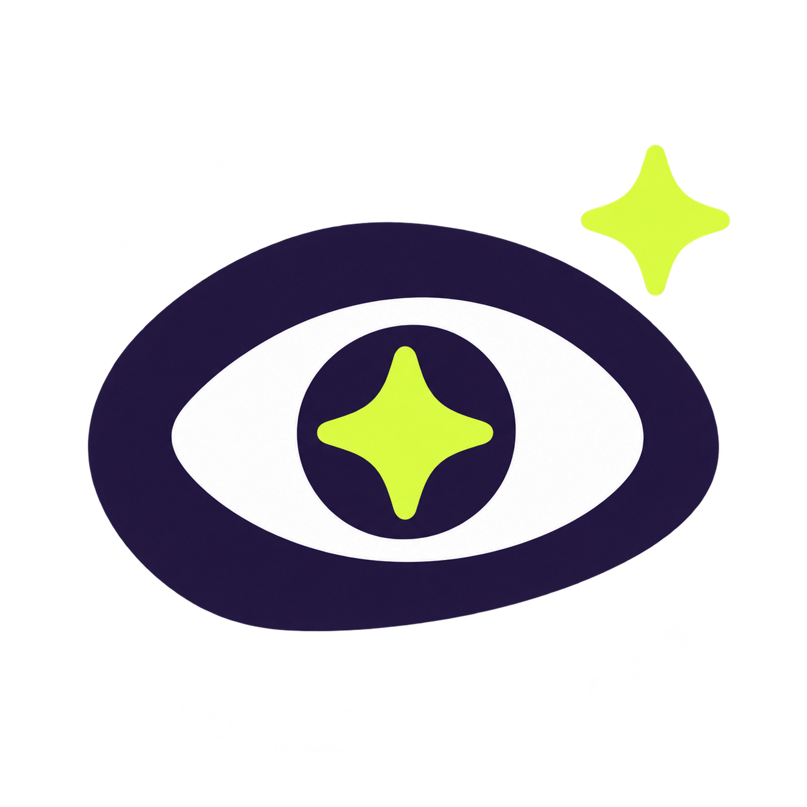

# ✨ Ooh Shiny



**Give your AI an eye for design.**

A portable UI/UX skill that helps AI coding agents research real references, spot interface problems, and build polished, responsive designs with purposeful motion. Works with your existing stack and preserves application behavior.

## Pick your mode

| Ask for | Get | Edits application code? |
| --- | --- | --- |
| Audit | Prioritized UI and usability findings | No |
| Suggest | Design directions, references and tradeoffs | No |
| Implement | Focused frontend improvements | Yes |
| Motion | Accessible transitions and interaction feedback | Yes |

No API key, MCP server, paid gallery subscription, or animation library is required by this package. Your AI host may require a subscription. Live research, previews and implementation depend on its tools.

## Install

Clone this repository, then choose **one** installation method per host:

```sh
git clone https://github.com/paulsonrison/ooh-shiny.git
```

### Codex plugin

The repository contains a portable root manifest, Codex compatibility manifest, and local marketplace. In current Codex CLI:

```sh
codex plugin marketplace add paulsonrison/ooh-shiny
codex plugin add ooh-shiny@ooh-shiny-marketplace
```

Restart Codex if needed, then select Ooh Shiny or invoke `$ooh-shiny`. See [installation details](docs/installation.md) for offline personal marketplace setup.

### Claude Code plugin

In Claude Code:

```text
/plugin marketplace add paulsonrison/ooh-shiny
/plugin install ooh-shiny@ooh-shiny-marketplace
/ooh-shiny:ooh-shiny Audit my UI without changing files.
```

### Standalone skill: Codex, Cursor, Copilot and other agents

Copy the entire `skills/ooh-shiny` folder, including its references, to a supported skills directory:

| Host | Project directory | Personal directory |
| --- | --- | --- |
| Codex | `.agents/skills/ooh-shiny/` | `~/.agents/skills/ooh-shiny/` |
| Cursor | `.cursor/skills/ooh-shiny/` | `~/.cursor/skills/ooh-shiny/` |
| GitHub Copilot | `.github/skills/ooh-shiny/` | `~/.copilot/skills/ooh-shiny/` where supported |
| Claude Code | `.claude/skills/ooh-shiny/` | `~/.claude/skills/ooh-shiny/` |

Project skills travel with your repository; personal skills do not automatically reach cloud agents. Restart or refresh the host after installation. See [compatibility and verification](docs/installation.md).

For an AI without native skills, attach `SKILL.md` and relevant reference files and ask it to follow them. This is a manual fallback, not a native plugin integration.

## Try it

In Codex, prefix requests with `$ooh-shiny`. In Cursor, find Ooh Shiny using `/`. Other hosts can select it automatically for relevant requests.

```text
$ooh-shiny Audit my dashboard. Prioritize usability issues. Do not modify files.
$ooh-shiny Suggest navbar directions using Navbar Gallery. Keep my brand.
$ooh-shiny Research a hero direction using Supahero. Do not implement yet.
$ooh-shiny Improve these CTA buttons while preserving their event handlers.
$ooh-shiny Review our theme using Refero Styles as inspiration.
$ooh-shiny Improve card and menu transitions, including reduced motion.
```

## The reference shelf

[Navbar Gallery](https://www.navbar.gallery/) · [Supahero](https://supahero.io/) · [CTA Gallery](https://www.cta.gallery/) · [Footer Design](https://www.footer.design/) · [3Dicons](https://3dicons.co/) · [Scrolltide](https://www.scrolltide.co/) · [Refero Styles](https://styles.refero.design/)

The skill selects sources relevant to the task, cites examples it actually inspected, and continues honestly when browsing is unavailable. Gallery links are starting points, not bundled assets or endorsements. See [source guidance](skills/ooh-shiny/references/design-sources.md).

## Package and validate

Python 3.11+; validation additionally uses PyYAML and jsonschema:

```sh
python -m pip install -r requirements-dev.txt
python scripts/validate.py
python scripts/package.py
```

Archives are generated in `dist/` from the shared skill: a complete plugin ZIP and a standalone skill ZIP. Download the repository ZIP from GitHub's **Code → Download ZIP**, or build the two focused archives locally. See [evaluation scenarios](evals/scenarios.md) and [validation results](docs/validation.md).

## Contribute

Open an issue with a real request, expected behavior, actual result, host/version and minimal reproducible context. For pull requests, keep the shared skill concise, put conditional detail in references, and run validation. Do not include private project data or third-party gallery assets. Improvements should help agents make better design decisions, not impose one visual style on every product.

MIT licensed. Created by [Paulson K R](https://github.com/paulsonrison). Not affiliated with the listed AI tools or design galleries.
